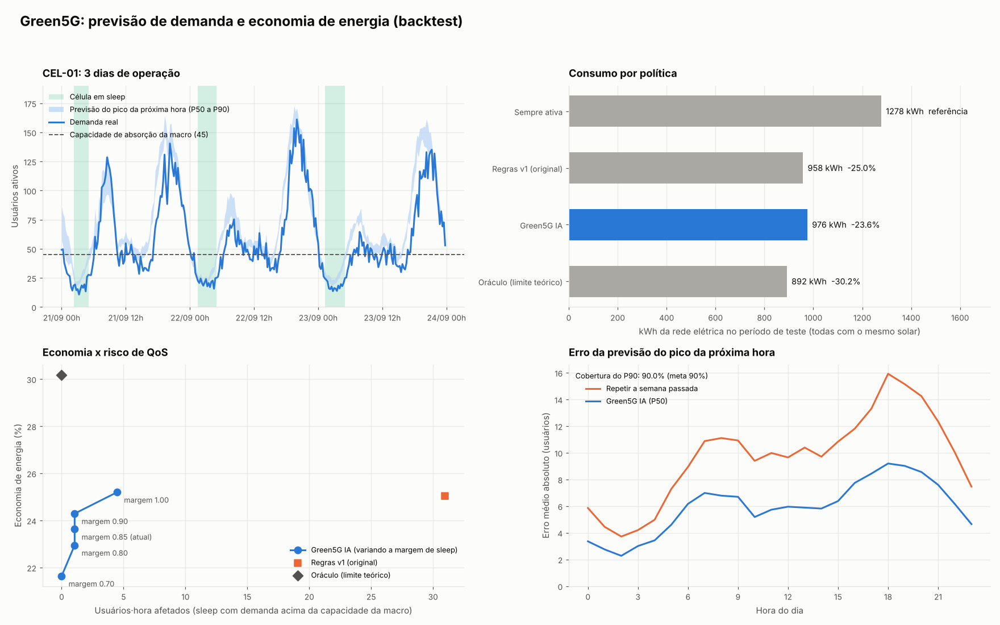

# Green5G v2: economia de energia em redes 5G com IA

O Green5G decide, a cada intervalo de medição (ex.: 15 min), se cada **célula de capacidade** 5G pode entrar em **sleep**. Quando ela dorme, a **macrocélula de cobertura** atende os usuários dela.

A IA prevê o **pico de demanda da próxima hora** com uma faixa de incerteza. A célula só dorme se até o cenário pessimista (P90) couber na macro. Ou seja, a economia nunca é obtida à custa da qualidade de serviço.

```
dados (CSV do OSS ou simulados)
  └─> features sem vazamento (hora, dia, histórico recente, mesma janela ontem/semana passada)
        └─> previsão quantílica P50/P90 do pico da próxima hora (gradient boosting)
              └─> calibração conformal (garante que o P90 cubra ~90% dos casos)
                    └─> política segura (histerese, proteção reativa, modo seguro, horas protegidas)
                          └─> decisão ATIVA/SLEEP + motivo legível + log de auditoria
```

## Começo rápido

```bash
pip install -r requirements.txt
python -m green5g demo        # simula, avalia, treina e decide (≈ 30 s)
python -m pytest -q           # testes automáticos
```

### No Google Colab

[Abrir o notebook no Colab](https://colab.research.google.com/github/ClethieB-cmd/Green5G/blob/main/notebooks/Green5G_Colab.ipynb) e usar **Ambiente de execução → Executar tudo**. O notebook baixa o projeto do GitHub sozinho.



A demo gera:

- `resultados/relatorio.md`: relatório completo
- `resultados/dashboard.png`: gráficos
- `resultados/resultados.json`: todos os números
- `resultados/decisoes_backtest.csv`: cada decisão com o motivo
- `modelos/green5g.joblib`: modelo treinado

## O que mudou em relação à versão 1

| Problema na v1 | Como a v2 resolve |
|---|---|
| A IA copiava as regras: 100% de acurácia não provava nada | A IA **prevê a demanda futura**. É avaliada contra o valor real e contra uma referência ingênua (repetir a semana passada). |
| Usava o tráfego da hora atual para decidir a hora atual | O alvo é o pico das **próximas** 60 min. As features usam só o passado, e um teste automático garante isso. |
| Split aleatório numa série temporal; previsão no próprio treino | **Backtest walk-forward**: retreina a cada semana só com o passado e tem purga na fronteira. |
| Tráfego caía de ~69 para ~15 à meia-noite (gaussiana não circular) | Picos **circulares**. A simulação também inclui perfis diferentes, feriados, eventos, ruído e falhas de coleta. |
| 46% de economia misturava solar com sleep | Todas as políticas têm o mesmo solar. A economia medida é **só a da decisão**, com e sem solar. |
| Ninguém media o que acontecia com os usuários | Métricas de **QoS**: violações e usuários·hora afetados quando a macro não comporta. |
| Potência constante, sem custo de religar, sem a macro | Potência **dependente da carga** (modelo tipo EARTH), custo de religamento e consumo extra da macro. |
| Regra "se tem sol, liga" (contrária ao objetivo) | Removida da política nova. A v1 é mantida só como comparação. |
| Fator de CO₂ e tarifa sem fonte | Ficam em `config.py`, com a fonte e um aviso para atualizar. |

## Resultados na simulação

Os dados são simulados: 6 células, 10 semanas, medição a cada 15 min, teste nas últimas 3 semanas.

| Política | Economia | Violações de QoS | Usuários·h afetados |
|---|---|---|---|
| Regras v1 (original) | 25,0% | 0,27% do tempo | 31,0 |
| **Green5G IA** | **23,6%** | **0,01% do tempo** | **1,1** |
| Oráculo (sabe o futuro, limite teórico) | 30,2% | 0% | 0 |

Para quase a mesma economia das regras, a IA afeta **~28× menos usuários**. Ela também funciona em qualquer perfil de célula sem horários fixos no código. A previsão erra em média ~6 usuários, é ~39% melhor que repetir a semana passada, e o P90 cobre 90,0% dos casos.

O relatório traz uma **curva economia × risco** (margem de sleep de 0,70 a 1,00). Com ela, a operadora escolhe o nível de risco que aceita.

> Estes números vêm de dados simulados e de parâmetros de exemplo. Eles mostram que o método funciona, mas não são uma promessa de economia. O número que vale é o que sair do `avaliar` com os **dados reais** da operadora.

## Usando dados reais

Formato do CSV (uma linha por célula por intervalo):

```
timestamp,celula_id,demanda,solar_w
2026-08-03 00:00:00,CEL-01,14.2,0
```

- `demanda`: usuários ativos (ou % de PRB, ou volume). Use a mesma medida em tudo, inclusive na `capacidade_absorcao_macro`.
- `solar_w` é opcional.
- Se as colunas tiverem outro nome: `--col-tempo`, `--col-celula`, `--col-demanda`, `--col-solar`.
- Lacunas de até 1 h são interpoladas. Lacunas maiores ficam vazias, e a política entra em **modo seguro** (célula ativa).

```bash
python -m green5g avaliar --dados meus_dados.csv --config minha_config.json   # mínimo ~5 semanas
python -m green5g treinar --dados meus_dados.csv --modelo modelos/green5g.joblib
python -m green5g decidir --dados ultimos_9_dias.csv --modelo modelos/green5g.joblib --estado estado.json
```

O comando `decidir` foi feito para rodar a cada 15 min (agendador). Ele devolve, por célula, o modo do próximo intervalo e o motivo, mantém o estado em `estado.json` e acrescenta tudo em `decisoes_log.csv`.

### Parâmetros que você PRECISA trocar (em `green5g/config.py` ou num JSON)

| Parâmetro | O que é | De onde tirar |
|---|---|---|
| `potencia_ociosa_w`, `potencia_max_w`, `potencia_sleep_w` | Consumo do equipamento | Ficha técnica do fornecedor ou medição no site |
| `capacidade_absorcao_macro` | Quanto a macro aguenta a mais sem degradar | Engenharia de RF / dimensionamento |
| `energia_religamento_wh` | Custo de cada religamento | Ficha técnica / medição |
| `custo_macro_w_por_usuario` | Consumo extra da macro | Medição |
| `tarifa_r_kwh` | Tarifa com impostos | Conta de energia |
| `fator_co2_kg_kwh` | Fator de emissão do SIN | MCTI (usar o anual mais recente) |
| `horizonte_min` | Janela que a decisão olha | Tempo real de religamento da célula |
| `horas_protegidas` | Horas em que nunca se dorme | Regra de negócio da operadora |

## Caminho até o teste na vida real

1. **Dados históricos reais.** Exporte 1 a 3 meses de contadores de desempenho (PM counters) das células e rode o `avaliar`.
2. **Modo sombra (2 a 4 semanas).** Rode o `decidir` a cada 15 min sem aplicar nada e compare o log com o que aconteceu.
3. **Piloto pequeno.** Use poucas células de capacidade com boa cobertura de macro, comece pela madrugada e use `horas_protegidas` no resto.
4. **Integração.** Aplique a decisão pela interface de gerência do fornecedor (OSS/EMS). Em redes O-RAN, isso pode virar um rApp ou xApp de economia de energia.
5. **KPIs do piloto.** Acompanhe kWh medidos, taxa de queda de chamadas, throughput, acessibilidade e reclamações na área.

## Limitações conhecidas

- **Demanda durante o sleep.** Com a célula dormindo, a demanda da área dela precisa ser estimada a partir da macro (contadores por setor ou medições dos UEs). Em dados reais, essa é a primeira coisa a resolver.
- **Granularidade.** A decisão vale para o próximo intervalo. Se o religamento for mais lento que isso, aumente `horizonte_min`.
- **Solar.** O modelo não considera bateria: o excedente solar é perdido.
- **Calibração.** O P90 é calibrado com a última semana de treino. Mudanças grandes no padrão de tráfego são detectadas pelo monitor de calibração, que coloca a célula em modo seguro, mas exigem retreino.

## Estrutura

```
green5g/
  config.py      parâmetros (com fontes e suposições marcadas)
  dados.py       simulador realista + leitor/validador de CSV
  features.py    features sem vazamento
  modelo.py      previsão quantílica + calibração conformal + salvar/carregar
  politica.py    políticas: Green5G IA, regras v1, sempre ativa, oráculo
  energia.py     energia, custo, CO2 e QoS
  avaliacao.py   backtest walk-forward, sensibilidade, relatório
  operacao.py    decisão em tempo real com estado e log de auditoria
  dashboard.py   gráficos
  __main__.py    linha de comando
notebooks/       notebook para o Google Colab
tests/           testes automáticos
```

## Licença

MIT (ver `LICENSE`). Dados de operadoras nunca devem ser publicados: o `.gitignore` já bloqueia arquivos CSV, Parquet e Excel.
